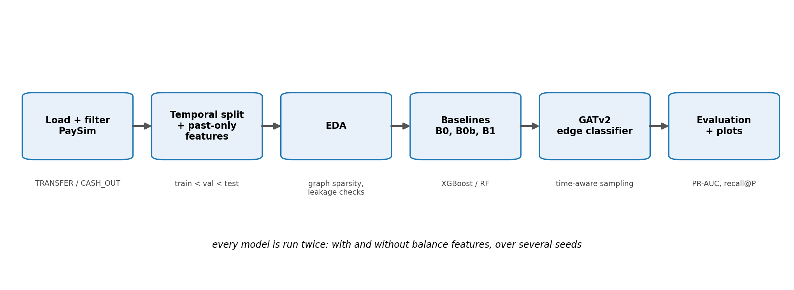
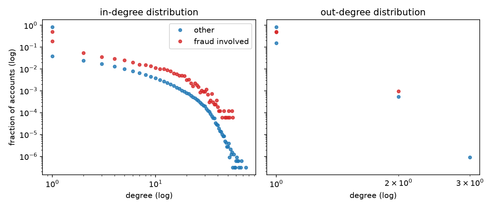
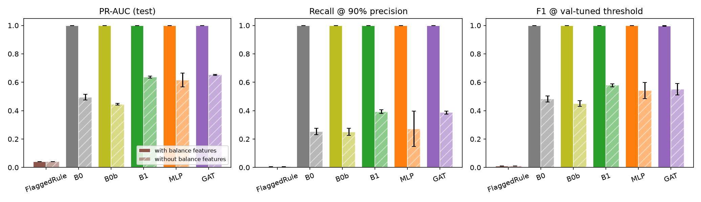
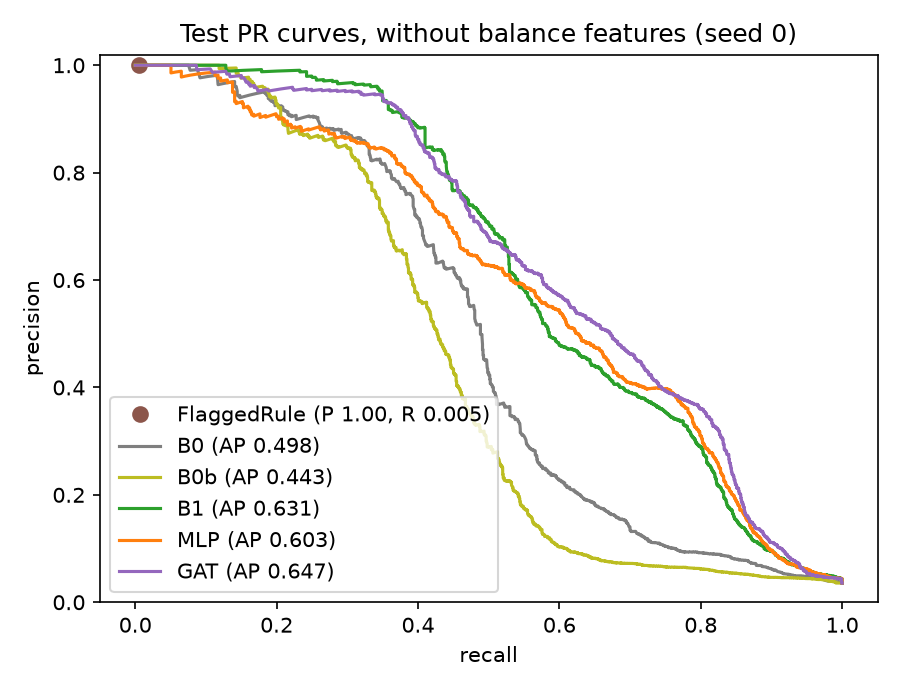
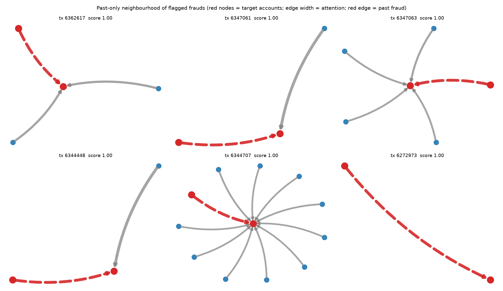
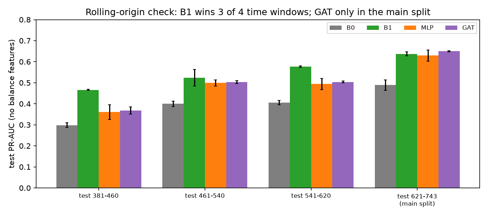
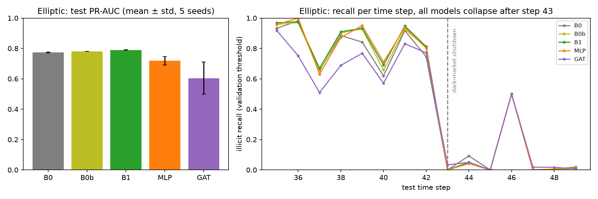

# Does graph learning help fraud detection? GATv2 vs. strong non-graph models on PaySim and Elliptic

**Question.** Does an attention-based graph neural network (GATv2) that learns from the transaction graph beat strong
non-graph models, including gradient boosting that is *given* hand-crafted, past-only graph features? Everything is
evaluated on a strict temporal split, with five seeds per model, and with an identical-architecture **MLP control** so
that "the graph helped" can be separated from "a neural network helped".

**Answer in one paragraph.** Graph information clearly helps: past-only neighbourhood features lift XGBoost from
0.49 to 0.64 PR-AUC on PaySim (once the balance columns that leak the label are removed). A GATv2 that learns from the
graph end-to-end, however, does **not** reliably beat XGBoost with those features (B1). On the main PaySim split the GAT
is ahead (**0.652 ± 0.004 vs 0.635 ± 0.007**, 5/5 paired seeds), but B1 is better on that split's validation data, and a
rolling-origin check on three earlier time windows reverses the result: **B1 wins all three, on validation and on test**
(GAT ahead in 1 of 9 paired runs). On Elliptic (real Bitcoin transactions), tree models are best (B1 0.789) and the GAT
(0.605) is below its own no-graph MLP control (0.718). The one consistent graph effect inside the neural models is small:
on PaySim the GAT is 0.004-0.04 PR-AUC above the identical network without neighbours in all four time windows.

* **PaySim** (Kaggle `ealaxi/paysim1`): synthetic mobile-money log, 6.36M transactions. Accounts = nodes, transactions =
  directed edges; task = **edge classification** (`isFraud`).
* **Elliptic** (Weber et al. 2019, via PyG): 203,769 real Bitcoin transactions, 234,355 flows, 49 time steps; task =
  **node classification** (illicit vs licit; 46,564 labelled).
* Models: **B0** XGBoost (raw features) · **B0b** Random Forest (raw) · **B1** XGBoost (raw + past-only graph features) ·
  **MLP** (the GAT network with all edges removed) · **GAT** (GATv2) · reference: PaySim's own `isFlaggedFraud` rule.



## Repository layout

```
configs/default.yaml          all hyper-parameters (override with --set section.key=value)
src/data.py splits.py features.py     loading, temporal split, past-only features (single source of truth)
src/eda.py                    EDA + computed graph-structure verdict
src/baselines.py              B0, B0b, B1, isFlaggedFraud reference
src/graph_build.py gat.py train_gat.py    time-aware sampler, GATv2 edge classifier, training, sanity overfit
src/evaluate.py               metrics, validation-only thresholds, seed aggregation
src/error_analysis.py plots.py            GAT-vs-B1 error analysis, result figures
src/elliptic.py               second dataset: Elliptic (B0, B0b, B1, MLP, GAT), same metrics and protocol
scripts/tune_elliptic.py      validation-only hyper-parameter grid for the Elliptic GAT / MLP
scripts/rolling_origin.py     PaySim rolling-origin check: B0/B1/MLP/GAT retrained on three earlier time windows
scripts/make_synthetic_paysim.py          small PaySim-shaped data for smoke tests
scripts/make_colab_notebook.py            regenerates notebooks/run_on_colab.ipynb
docs/diagrams/                reproducible diagram scripts (PNG + SVG): python docs/diagrams/make_all.py
docs/figures/                 result figures shown in this README (copied from figures/)
tests/                        leakage, feature and end-to-end smoke tests
```

## Run locally on synthetic data (CPU, minutes)

```bash
pip install -r requirements.txt
python scripts/make_synthetic_paysim.py                      # -> data/synthetic_paysim.csv
python -m pytest tests -q
S="--data_path data/synthetic_paysim.csv --results_dir results/synth --figures_dir figures/synth"
python -m src.eda $S
python -m src.baselines $S --seeds 0 1 --set baselines.xgb.n_estimators=60
python -m src.train_gat $S --sanity_overfit --set gat.sanity.n_edges=600 --set gat.sanity.epochs=60
python -m src.train_gat $S --seeds 0 1 --set gat.epochs=3
python -m src.evaluate --results_dir results/synth
python -m src.error_analysis $S --seeds 0
python -m src.plots $S
```

The synthetic file is **not** PaySim: its numbers say nothing about real performance and are only used to check that the code runs.
All entry points accept `--config`, `--use_balance true|false|both`, `--seeds`, `--max_rows`, `--data_path`, `--results_dir`.

## Run on Colab (GPU)

Open `notebooks/run_on_colab.ipynb` on a T4 GPU runtime. First add your Kaggle API token as a Colab Secret named
`KAGGLE_API_TOKEN` (key icon in the left sidebar, *Notebook access* on). The notebook clones this repo from GitHub,
installs dependencies, downloads PaySim, runs tests, a quick trial, EDA, baselines, the GAT sanity checks, GAT training
(in the background, logged to Drive), evaluation and plots.

Free Colab disconnects, so data, cache, results, figures and logs live on Google Drive
(`MyDrive/paysim-gnn-fraud-outputs`), set through the `PAYSIM_DATA_PATH`, `PAYSIM_CACHE_DIR`, `PAYSIM_RESULTS_DIR`
and `PAYSIM_FIGURES_DIR` environment variables (CLI flags still win). `src.baselines` and `src.train_gat` skip
(model, mode, seed) runs already in `metrics_per_run.csv`, so after a disconnect you just re-run the cell
(`--rerun` forces a retrain).
The equivalent commands are listed at the end of this file.

## Design decisions

| Topic | Decision | Why |
|---|---|---|
| Rows | Only `TRANSFER` and `CASH_OUT` (`data.filter_types`); dropped rows are logged | Fraud occurs only there (verified by the EDA, not assumed) |
| Split | Contiguous on `step`: train <= 500 < val <= 620 < test; fails loudly if a split has fewer than `min_frauds_per_split` frauds | Time-respecting evaluation |
| `--max_rows` | Reads the first N raw rows; split boundaries are rescaled by `max_step/743` so all splits exist | Quick runs |
| Past-only rule | Features of a transaction at step `t` use only transactions of the same account with **step strictly < t**. Same-step rows are invisible, whatever their row order | PaySim has no trustworthy order inside a step; conservative |
| Labels | `isFraud` of other transactions is never a feature (no neighbour fraud rates) | Leakage |
| Scaling | signed `log1p` on heavy-tailed columns, then standardisation fitted on the **train split only** | Leakage |
| Thresholds | F1-optimal threshold chosen on validation; test scored once per model/seed | Leakage |
| Balance mode | `use_balance=false` drops `oldbalanceOrg, newbalanceOrig, oldbalanceDest, newbalanceDest` and the derived `errorBalance*` columns | Near-label leakage in PaySim |
| GNN neighbourhood | Per-target sampled subgraph of edges with `step < t` (strict); target edge excluded; fanout `[10, 5]`, most recent edges first (`gat.sampling: uniform` also available); edges used in both directions with a direction flag and edge age | Time-aware message passing; same-step edges excluded for the same reason as above |
| Custom sampler (**deviation from the spec**) | `src/graph_build.py` instead of PyG `LinkNeighborLoader(time_attr=...)` | PyG's temporal sampling (installed 2.8.1: `time_attr`, `edge_label_time`, `temporal_strategy`; temporal implies `disjoint`) needs the optional `pyg-lib`/`torch-sparse` backend, which was not installable on the Windows/CPU dev machine, so it could not be tested here. The numpy sampler is unit-tested for leakage (`tests/test_leakage.py`). PyG's time filter is believed to be inclusive (`time <= seed_time`) - **unverified**; to get the same strict rule use `edge_label_time = step - 1`. `scripts/check_pyg_sampler.py` / `tests/test_pyg_sampler.py` (skipped without pyg-lib; notebook cell 4b) check this on Colab |
| Node inputs | Constant vector; all time-varying account information enters as edge features (same code as B1 features) | Spec |
| Skip connections | GATv2Conv has no self-loops (`add_self_loops=False`); a linear skip + LayerNorm is used instead | Robust to nodes without past edges |
| Imbalance | BCE with `pos_weight` (or focal loss), training negatives subsampled per epoch (`train_neg_per_pos`, default 20) | Speed; early stopping uses a negative-subsampled validation set (`val_neg_per_pos`), while the threshold and reported validation AP use the full validation split |
| XGBoost | `scale_pos_weight = min(neg/pos, 100)`, early stopping on validation `aucpr` with a patience of 100 rounds | Stability; 40 rounds let some seeds stop after a few trees |
| Random Forest | Above `rf.max_train_rows` negatives are subsampled (all frauds kept) | Memory/time on ~2M training rows |
| Determinism | Seeds for python/numpy/torch/xgboost/sklearn; `use_deterministic_algorithms(warn_only=True)` | GPU scatter ops are not fully deterministic, so GPU reruns can differ slightly |

Metrics: PR-AUC (primary), recall at 90% and 50% precision, precision/recall/F1 and confusion matrix at the validation-tuned threshold.
Accuracy is never computed. `isFlaggedFraud` is evaluated at its fixed 0/1 decision (no tuning).

## Outputs

* `results/metrics_per_run.csv`, `results/metrics_summary.csv` (mean ± std over seeds, per feature mode)
* `results/predictions_<model>_<mode>_seed<k>.parquet` (test transaction id, label, score)
* `results/checkpoints/{gat,mlp}_<mode>_seed<k>.pt` (weights + validation-tuned threshold), `results/attention_examples_*.json`
* `results/eda_summary.json` (including the computed graph-structure verdict), `results/error_analysis_*.csv`
* `results/elliptic/`: Elliptic metrics, predictions, `per_step.csv` (recall per test step), `tuning.csv` (validation grid)
* `figures/`: PR curves, summary bars, confusion matrices, degree distributions, fraud over time, neighbourhood graphs with attention, Elliptic results

## Results

All numbers are on the **test** split, mean ± std over 5 seeds (0-4). F1 thresholds are chosen on validation only.
Measured on one laptop (RTX 5050 Laptop GPU, 16 GB RAM): baselines ~7 min, GAT ~2.5 min per seed and mode
(~25 min for all 10 runs), MLP control ~6 min, the whole Elliptic experiment ~6 min.

### PaySim: data facts that shape everything (`python -m src.eda`)

* 6,362,620 transactions, 8,213 frauds (0.129%). Every fraud is a `TRANSFER` or `CASH_OUT`, so only those 2,770,409 rows are kept.
* **Balance leakage:** the "origin account drained" pattern appears in 97.7% of frauds and in 0.00% of non-frauds (a
  rule with 100% precision). Any model that sees the balance columns scores ~1.0, so the no-balance setting is the real test.
* **Graph-structure verdict: SPARSE (4/4 conditions).** Mean degree 1.69, 88.3% of accounts have a single transaction,
  the largest weakly connected component has 90 accounts, and the median degree of fraud-involved accounts is 1. Fraud
  senders practically never have an earlier transaction (0.001 on average in the test split), so any graph signal
  has to come from the *receiver* side.
* Temporal split (train step ≤ 500, val 501-620, test 621-743): fraud rate 0.21% / 1.49% / 3.55%. Late steps have
  far fewer legitimate transactions, so the base rate differs a lot between splits.



### PaySim results

**Without balance features (the meaningful comparison)**

| Model | PR-AUC | Recall@90%P | Recall@50%P | F1 (val thr.) |
|---|---|---|---|---|
| isFlaggedFraud rule | 0.040 | 0.005 | 0.005 | 0.010 |
| B0 XGBoost, raw | 0.494 ± 0.020 | 0.253 ± 0.023 | 0.479 ± 0.033 | 0.482 ± 0.021 |
| B0b Random Forest, raw | 0.445 ± 0.006 | 0.250 ± 0.025 | 0.429 ± 0.005 | 0.450 ± 0.020 |
| B1 XGBoost, raw + graph features | 0.635 ± 0.007 | **0.393 ± 0.013** | 0.598 ± 0.022 | **0.579 ± 0.011** |
| MLP control (GAT without neighbours) | 0.616 ± 0.049 | 0.272 ± 0.124 | 0.636 ± 0.063 | 0.541 ± 0.057 |
| **GAT** | **0.652 ± 0.004** | 0.386 ± 0.011 | **0.673 ± 0.015** | 0.550 ± 0.040 |

**With balance features:** every trained model reaches PR-AUC ≥ 0.9999 and F1 ≥ 0.997 (full table in
`results/metrics_summary.csv`). This is the leakage described above, not model quality.

How to read it:

* **Graph features matter a lot:** B0 → B1 is +0.14 PR-AUC from past-only account aggregates alone.
* **GAT vs B1:** the GAT is ahead in PR-AUC in 5/5 paired seeds (per-seed gains +0.002 to +0.027, mean +0.017) and
  clearly ahead in the middle of the precision-recall curve (recall at 50% precision 0.673 vs 0.598). At 90% precision
  they are equal, and B1 has the better F1 at the validation-chosen threshold.
* **GAT vs MLP (same network, no neighbours):** +0.037 mean PR-AUC and about 10x lower seed variance, but ahead in only
  3/5 paired seeds. Message passing makes the network more reliable more than it makes it much better.
* **Caveat: validation disagrees.** On validation, B1 has PR-AUC 0.558 vs 0.489 for the GAT, so a validation-based
  model choice would have picked B1. The rolling-origin check below shows the test-split win does not generalise.
* **What the GAT catches that B1 does not** (`python -m src.error_analysis`, seed 0, at 90% precision): 75 frauds are
  caught only by the GAT and 76 only by B1. The GAT-only frauds go to receivers with much more history (3.7 earlier
  transactions on average vs 0.1 for the B1-only ones) and are smaller (median 0.40M vs 1.70M). The GAT uses the
  receiver's neighbourhood, which is where PaySim has structure.





### PaySim rolling-origin check (`python -m scripts.rolling_origin`)

One test window can be lucky, so B0, B1, MLP and GAT were retrained from scratch on three earlier windows: train on
steps 1..T, validate on the next 80 steps, test on the 80 after that (T = 300, 380, 460), without balance features,
seeds 0-2, same settings as above. Later steps are excluded from every split (`split.test_end_step`).

| Test window (steps) | test frauds | B0 | B1 | MLP | GAT | GAT - B1, test (wins) | GAT - B1, val (wins) |
|---|---|---|---|---|---|---|---|
| 381-460 | 916 | 0.298 | **0.466** | 0.361 | 0.368 | -0.097 (0/3) | -0.342 (0/3) |
| 461-540 | 838 | 0.400 | **0.524** | 0.499 | 0.503 | -0.021 (1/3) | -0.125 (0/3) |
| 541-620 | 856 | 0.406 | **0.577** | 0.494 | 0.504 | -0.074 (0/3) | -0.031 (0/3) |
| 621-743 (main split, seeds 0-2) | 1,366 | 0.489 | 0.637 | 0.629 | **0.650** | +0.013 (3/3) | -0.069 (0/3) |

* B1 is the best model in 3 of 4 windows, and on validation in all 4. The GAT's win on the main split is specific to that period.
* GAT ≥ MLP in every window (+0.004 to +0.021 here): message passing adds a little to the neural model, but not enough
  to catch up with gradient boosting on hand-made graph features.
* The earliest window is hardest for the neural models: its validation period has a fraud rate of only 0.13%
  (vs 1.9% later), which makes early stopping on validation PR-AUC very noisy.



### Elliptic results (`python -m src.elliptic`)

Split: train steps 1-29, validation 30-34, test 35-49 (the standard 34/15 boundary of Weber et al., with the last five
training steps held out). Every Elliptic edge joins two transactions of the same time step (checked at load time), so
the GAT never sees the future. B1 uses Elliptic's 72 pre-computed one-hop aggregate features; the GAT and MLP use only
the 93 local features and must learn neighbourhood information themselves. GAT and MLP settings were chosen by a small
grid on **validation** PR-AUC only (`scripts/tune_elliptic.py`, results in `results/elliptic/tuning.csv`).

| Model | PR-AUC | Recall@90%P | Recall@50%P | F1 (val thr.) |
|---|---|---|---|---|
| B0 XGBoost, local | 0.774 ± 0.003 | 0.663 ± 0.007 | 0.751 ± 0.003 | 0.743 ± 0.019 |
| B0b Random Forest, local | 0.781 ± 0.001 | 0.708 ± 0.001 | 0.751 ± 0.001 | **0.765 ± 0.014** |
| **B1 XGBoost, local + aggregated** | **0.789 ± 0.001** | **0.722 ± 0.001** | **0.752 ± 0.002** | 0.747 ± 0.023 |
| MLP control | 0.718 ± 0.027 | 0.632 ± 0.018 | 0.715 ± 0.013 | 0.552 ± 0.033 |
| GAT | 0.605 ± 0.105 | 0.279 ± 0.260 | 0.665 ± 0.019 | 0.589 ± 0.048 |

* Trees win, as in the original Elliptic paper. Pre-computed neighbour features help a little (B0 → B1, +0.015).
* The GAT is **better than the MLP on validation** (PR-AUC 0.942 vs 0.930) but **worse on test**, with large seed
  variance: what it learns from neighbourhoods does not transfer forward in time.
* All models collapse after test step 43 (recall ≤ 3%), the point Weber et al. attribute to a dark-market shutdown:
  new illicit behaviour that no model trained on the past can recognise.



### Conclusion

Graph context is valuable for fraud detection on both datasets, but its value is captured best by simple past-only
neighbourhood aggregates fed to gradient boosting. A GATv2 trained end-to-end beat that baseline in one of four PaySim
time windows and on neither validation nor test anywhere else, and it is worse on Elliptic, where what it learns
does not generalise across time. Inside the neural models, message passing gives a small but consistent gain over the
same network without neighbours. In practice: build the graph features first, and evaluate any GNN on several
time-respecting windows; a single temporal split was enough here to produce a misleading "GNN wins" result.

### Checks that the results are not artefacts

* Leakage tests (`tests/test_leakage.py`): features and sampled neighbourhoods only use strictly earlier transactions.
* Sanity overfit: the GAT memorises a 2,100-edge subset in both feature modes (`results/sanity_overfit_*.json`: final
  loss 0.0000 / 0.047, train AP 1.000 / 0.996). Without balance features this needs many more epochs, which is why
  `gat.sanity.epochs` is 2000.
* XGBoost early stopping: with a patience of 40 rounds some seeds stopped after 2-8 trees on the noisy validation
  PR-AUC (one Elliptic B1 seed scored 0.36). All XGBoost results above use a patience of 100, so the baselines are not handicapped.
* Same-network control (MLP) on both datasets, 5 seeds on the main splits, paired per-seed comparisons, and a
  rolling-origin check over three more PaySim time windows (3 seeds each).

## Limitations

* PaySim is synthetic and its graph is extremely sparse. Elliptic is real but labels only 23% of nodes and is a
  different task (node, not edge, classification). Conclusions are about these two datasets.
* The rolling-origin windows use 3 seeds and 80-step validation/test windows; the main split uses 5 seeds and longer
  windows (120 / 123 steps), so the windows are comparable in design but not identical.
* Strict "step < t" visibility discards genuinely useful same-step history (for example a fraudulent transfer and its
  cash-out inside one hour); this is the price of the leakage-safe choice.
* The PaySim GAT hyper-parameters were fixed before seeing results and not tuned; only the Elliptic GAT/MLP were tuned (on validation).
* Negative subsampling during GAT training changes score calibration; the threshold is therefore tuned on the full validation split.
* The custom PaySim sampler was not cross-checked against PyG's temporal `LinkNeighborLoader`: `pyg-lib` has no
  Windows build for the torch version used, so `tests/test_pyg_sampler.py` is skipped and PyG's inclusive/exclusive
  time filter remains unverified (the check runs on Colab, notebook cell 4b).
* GPU scatter operations are not bit-deterministic, so reruns can differ in the last digits.

## Run everything locally (GPU recommended)

```bash
pip install -r requirements.txt     # for a GPU, install the CUDA build of torch from pytorch.org first
# download the PaySim zip from https://www.kaggle.com/datasets/ealaxi/paysim1 and unzip the CSV into data/
D=data/PS_20174392719_1491204439457_log.csv
python -m pytest tests -q
python -m src.eda --data_path $D
python -m src.baselines --data_path $D --use_balance both --seeds 0 1 2 3 4
python -m src.train_gat --data_path $D --sanity_overfit --use_balance true
python -m src.train_gat --data_path $D --sanity_overfit --use_balance false
python -m src.train_gat --data_path $D --use_balance both --seeds 0 1 2 3 4
python -m src.train_gat --data_path $D --use_balance both --seeds 0 1 2 3 4 --no_graph   # MLP control
python -m src.elliptic --seeds 0 1 2 3 4        # downloads Elliptic via PyG on first use
python -m scripts.rolling_origin --data_path $D   # three extra time windows, seeds 0-2 (~20 min on a laptop GPU)
python -m src.evaluate
python -m src.error_analysis --data_path $D --seeds 0 --precision 0.9
python -m src.plots --data_path $D
```

Finished (model, mode, seed) runs are skipped on a rerun; add `--rerun` to retrain them.

## Colab commands, in order

```bash
git clone https://github.com/rabeeh18/GNN-Based-Fraud-Detection && cd GNN-Based-Fraud-Detection
pip install torch_geometric xgboost pyarrow networkx pyyaml pytest -U kaggle
OUT=/content/drive/MyDrive/paysim-gnn-fraud-outputs
export PAYSIM_DATA_PATH=$OUT/data/PS_20174392719_1491204439457_log.csv PAYSIM_CACHE_DIR=$OUT/cache
export PAYSIM_RESULTS_DIR=$OUT/results PAYSIM_FIGURES_DIR=$OUT/figures
export KAGGLE_API_TOKEN=...   # in the notebook: from the Colab Secret, never typed into a cell
kaggle datasets download -d ealaxi/paysim1 -p /content/paysim_zip --unzip && mkdir -p $OUT/data && cp /content/paysim_zip/*.csv $OUT/data/
python -m pytest tests -q
python -m src.train_gat --seeds 0 --max_rows 500000 --set gat.epochs=3 --use_balance true --results_dir $OUT/trial/results
python -m src.eda
python -m src.baselines --use_balance both --seeds 0 1 2 3 4
python -m src.train_gat --sanity_overfit --use_balance true
python -m src.train_gat --sanity_overfit --use_balance false
nohup python -m src.train_gat --use_balance both --seeds 0 1 2 3 4 >> $OUT/logs/train_gat.log 2>&1 &
python -m src.evaluate
python -m src.error_analysis --seeds 0 --precision 0.9
python -m src.plots
```
