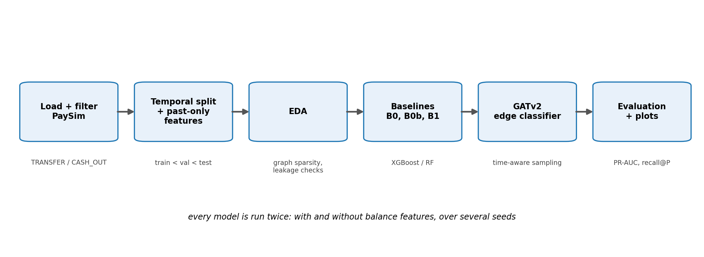

# Graph-based fraud detection on PaySim: does GATv2 beat strong non-graph models?

**Research question.** Does an attention-based GNN (GATv2) that learns from the account-transfer graph beat strong
non-graph models, including a gradient-boosted model that is given hand-crafted *past-only* graph features?
The result is reported honestly, win or lose. No results are stored in this repository until you run the pipeline.

* Dataset: PaySim (Kaggle `ealaxi/paysim1`, `PS_20174392719_1491204439457_log.csv`), synthetic mobile-money logs.
* Graph: accounts = nodes, transactions = directed edges (sender -> receiver). Task: **edge classification** (`isFraud`).
* Models: **B0** XGBoost (raw features) · **B0b** Random Forest (raw features) · **B1** XGBoost (raw + past-only graph features) ·
  **GAT** (GATv2 edge classifier) · reference: the dataset's own `isFlaggedFraud` rule.
* Every model runs with and without balance features (`use_balance`), because in PaySim the balance columns nearly leak the label.



## Repository layout

```
configs/default.yaml          all hyper-parameters (override with --set section.key=value)
src/data.py splits.py features.py     loading, temporal split, past-only features (single source of truth)
src/eda.py                    EDA + computed graph-structure verdict
src/baselines.py              B0, B0b, B1, isFlaggedFraud reference
src/graph_build.py gat.py train_gat.py    time-aware sampler, GATv2 edge classifier, training, sanity overfit
src/evaluate.py               metrics, validation-only thresholds, seed aggregation
src/error_analysis.py plots.py            GAT-vs-B1 error analysis, result figures
scripts/make_synthetic_paysim.py          small PaySim-shaped data for smoke tests
scripts/make_colab_notebook.py            regenerates notebooks/run_on_colab.ipynb
docs/diagrams/                reproducible diagram scripts (PNG + SVG): python docs/diagrams/make_all.py
tests/                        leakage, feature and end-to-end smoke tests
```

## Run locally on synthetic data (CPU, minutes)

```bash
pip install -r requirements.txt
python scripts/make_synthetic_paysim.py                      # -> data/synthetic_paysim.csv
python -m pytest tests -q
S="--data_path data/synthetic_paysim.csv --results_dir results/synth --figures_dir figures/synth"
python -m src.eda $S
python -m src.baselines $S --seeds 0 1 --set baselines.xgb.n_estimators=60
python -m src.train_gat $S --sanity_overfit --set gat.sanity.n_edges=600 --set gat.sanity.epochs=60
python -m src.train_gat $S --seeds 0 1 --set gat.epochs=3
python -m src.evaluate --results_dir results/synth
python -m src.error_analysis $S --seeds 0
python -m src.plots $S
```

The synthetic file is **not** PaySim: its numbers say nothing about real performance and are only used to check that the code runs.
All entry points accept `--config`, `--use_balance true|false|both`, `--seeds`, `--max_rows`, `--data_path`, `--results_dir`.

## Run on Colab (GPU)

Open `notebooks/run_on_colab.ipynb` (GPU runtime). It checks the GPU, installs dependencies, downloads PaySim with your
`kaggle.json`, runs tests, EDA, baselines, the GAT sanity check, GAT training, evaluation and plots, and copies outputs to Drive.
The equivalent commands are listed at the end of this file.

## Design decisions

| Topic | Decision | Why |
|---|---|---|
| Rows | Only `TRANSFER` and `CASH_OUT` (`data.filter_types`); dropped rows are logged | Fraud occurs only there (verified by the EDA, not assumed) |
| Split | Contiguous on `step`: train <= 500 < val <= 620 < test; fails loudly if a split has fewer than `min_frauds_per_split` frauds | Time-respecting evaluation |
| `--max_rows` | Reads the first N raw rows; split boundaries are rescaled by `max_step/743` so all splits exist | Quick runs |
| Past-only rule | Features of a transaction at step `t` use only transactions of the same account with **step strictly < t**. Same-step rows are invisible, whatever their row order | PaySim has no trustworthy order inside a step; conservative |
| Labels | `isFraud` of other transactions is never a feature (no neighbour fraud rates) | Leakage |
| Scaling | signed `log1p` on heavy-tailed columns, then standardisation fitted on the **train split only** | Leakage |
| Thresholds | F1-optimal threshold chosen on validation; test scored once per model/seed | Leakage |
| Balance mode | `use_balance=false` drops `oldbalanceOrg, newbalanceOrig, oldbalanceDest, newbalanceDest` and the derived `errorBalance*` columns | Near-label leakage in PaySim |
| GNN neighbourhood | Per-target sampled subgraph of edges with `step < t` (strict); target edge excluded; fanout `[10, 5]`, most recent edges first (`gat.sampling: uniform` also available); edges used in both directions with a direction flag and edge age | Time-aware message passing; same-step edges excluded for the same reason as above |
| Custom sampler | `src/graph_build.py` instead of PyG `LinkNeighborLoader(time_attr=...)` | PyG temporal sampling needs optional `pyg-lib`/`torch-sparse` wheels that depend on the torch/CUDA build and are unavailable on Windows/CPU. The numpy sampler has identical semantics and is unit-tested (`tests/test_leakage.py`) |
| Node inputs | Constant vector; all time-varying account information enters as edge features (same code as B1 features) | Spec |
| Skip connections | GATv2Conv has no self-loops (`add_self_loops=False`); a linear skip + LayerNorm is used instead | Robust to nodes without past edges |
| Imbalance | BCE with `pos_weight` (or focal loss), training negatives subsampled per epoch (`train_neg_per_pos`, default 20) | Speed; early stopping uses a negative-subsampled validation set (`val_neg_per_pos`), while the threshold and reported validation AP use the full validation split |
| XGBoost | `scale_pos_weight = min(neg/pos, 100)`, early stopping on validation `aucpr` | Stability |
| Random Forest | Above `rf.max_train_rows` negatives are subsampled (all frauds kept) | Memory/time on ~2M training rows |
| Determinism | Seeds for python/numpy/torch/xgboost/sklearn; `use_deterministic_algorithms(warn_only=True)` | GPU scatter ops are not fully deterministic, so GPU reruns can differ slightly |

Metrics: PR-AUC (primary), recall at 90% and 50% precision, precision/recall/F1 and confusion matrix at the validation-tuned threshold.
Accuracy is never computed. `isFlaggedFraud` is evaluated at its fixed 0/1 decision (no tuning).

## Outputs

* `results/metrics_per_run.csv`, `results/metrics_summary.csv` (mean ± std over seeds, per feature mode)
* `results/predictions_<model>_<mode>_seed<k>.parquet` (test transaction id, label, score)
* `results/checkpoints/gat_<mode>_seed<k>.pt` (weights + validation-tuned threshold), `results/attention_examples_*.json`
* `results/eda_summary.json` (including the computed graph-structure verdict), `results/error_analysis_*.csv`
* `figures/`: PR curves, summary bars, confusion matrices, degree distributions, fraud over time, neighbourhood graphs with attention

### Results

*Not available yet.* Generate with `python -m src.evaluate` after running the baselines and the GAT; it prints a Markdown table
built from `results/metrics_summary.csv`. Paste that table here, together with the EDA verdict, once you have run the real data.

| Mode | Model | PR-AUC | Recall@90%P | Recall@50%P | F1 |
|---|---|---|---|---|---|
| | | | | | |

## Expected runtime and memory (not measured on the real data)

* ~2.8M edges after filtering. Feature computation is vectorised (a few minutes, ~3-5 GB RAM peak because the event log has 5.6M rows); it is cached as parquet in `cache/`.
* GAT: with `train_neg_per_pos=20` an epoch uses ~20x the number of training frauds in edges, so epochs are short; the dominant cost is the full validation/test scoring at the end of each seed (numpy sampling on CPU is the bottleneck, not the GPU). Edge features live on the GPU (~2.8M x 42 float32, about 0.5 GB).
* Risks: free-Colab RAM (12 GB) during feature construction (use `--max_rows` first), session time limits with 5 seeds x 2 modes (run one seed first, copy outputs to Drive), Random Forest on large training sets (see `rf.max_train_rows`).

## Limitations

* PaySim is synthetic; conclusions may not transfer to real transaction data.
* PaySim customers rarely transact more than a few times, so the graph may be too sparse for a GNN to add information; the EDA prints a verdict computed from the data.
* Strict "step < t" visibility discards genuinely useful same-step history (for example a fraudulent transfer and its cash-out inside one hour); this is the price of the leakage-safe choice.
* Negative subsampling during GAT training changes score calibration; the threshold is therefore tuned on the full validation split.
* The custom sampler is not benchmarked against PyG's built-in temporal sampler.

## Colab commands, in order

```bash
pip install torch_geometric xgboost pyarrow networkx pyyaml pytest kaggle
kaggle datasets download -d ealaxi/paysim1 -p data --unzip
D=data/PS_20174392719_1491204439457_log.csv
python -m pytest tests -q
python -m src.eda --data_path $D
python -m src.baselines --data_path $D --use_balance both --seeds 0 1 2 3 4
python -m src.train_gat --data_path $D --sanity_overfit
python -m src.train_gat --data_path $D --use_balance both --seeds 0 1 2 3 4
python -m src.evaluate
python -m src.error_analysis --seeds 0 --precision 0.9
python -m src.plots
```
